<!--
  Art lives in ./assets as plain SVG (no third-party widgets or trackers).
  To change it, edit assets/src/*.py and run:
    python3 assets/src/banner.py assets && python3 assets/src/pipeline.py assets
-->

  <picture>
    <source media="(prefers-color-scheme: dark)" srcset="assets/banner-dark.svg">
    <source media="(prefers-color-scheme: light)" srcset="assets/banner-light.svg">
    
  </picture>

## 👋 Hi, I'm retromonalisa

I like computer vision that has to hold up outside the lab. Right now that means teaching a camera to spot drones against open sky, with the model running **on the image sensor itself**, and checking the results in real outdoor field tests.

## 🛰️ Currently building

### [seraphim-sky](https://github.com/retromonalisa/seraphim-sky)

Drone detection with the detector running on the camera's image sensor itself.

  <picture>
    <source media="(prefers-color-scheme: dark)" srcset="assets/pipeline-dark.svg">
    <source media="(prefers-color-scheme: light)" srcset="assets/pipeline-light.svg">
    
  </picture>

- **Data:** built on an 83k-image drone detection dataset
- **Train → deploy:** a documented pipeline from training to running on the sensor, plus a quick start
- **Field-tested:** a real drone over an open field, against a cloudy sky
- **License:** MIT

Related repo: [`imx500_seraphim_sky`](https://github.com/retromonalisa/imx500_seraphim_sky)

## 🧭 What I'm into

- 👁️ **Computer vision:** object detection, from dataset to deployed model
- 📟 **Edge AI:** models small enough to run on the device, or right on the sensor
- 🌤️ **Field testing:** real skies, real clouds, real drones

 

✦ thanks for stopping by ✦

